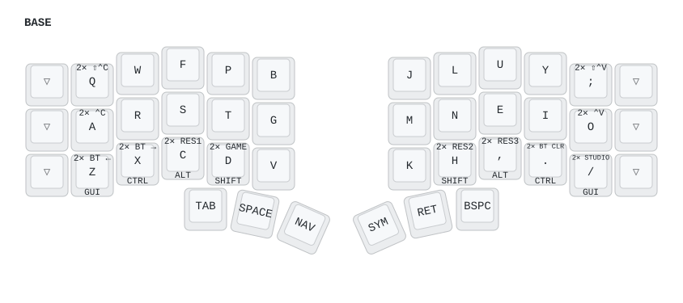
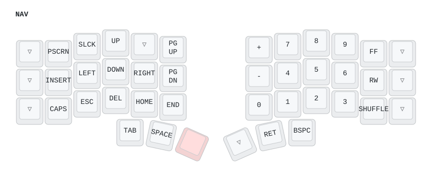
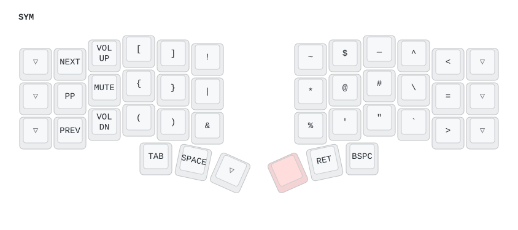
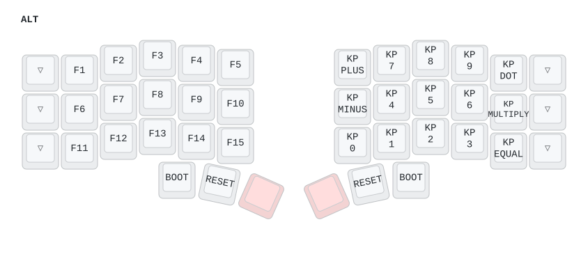
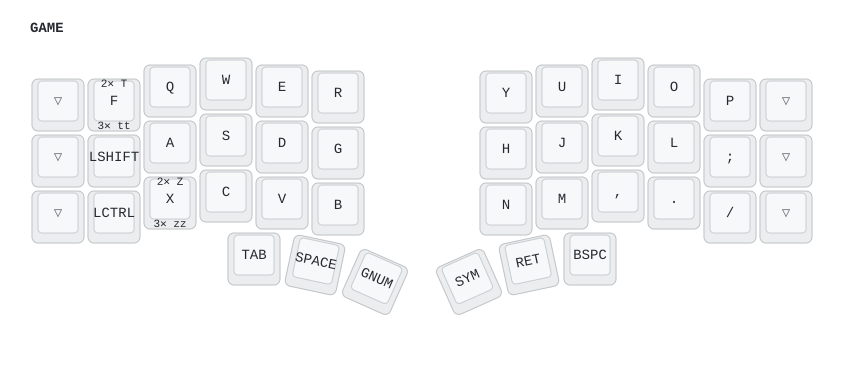
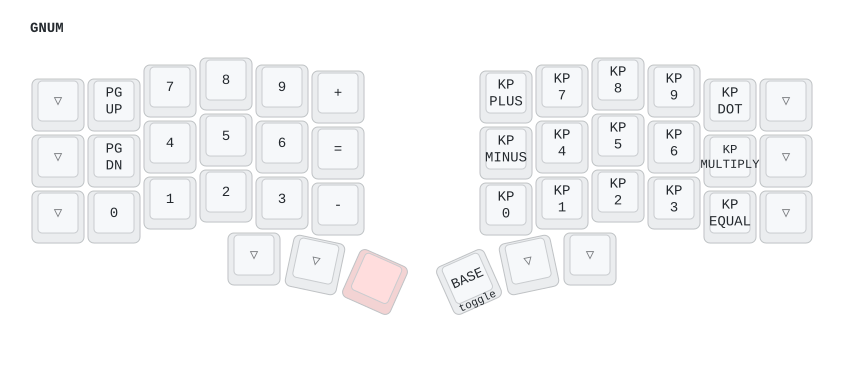
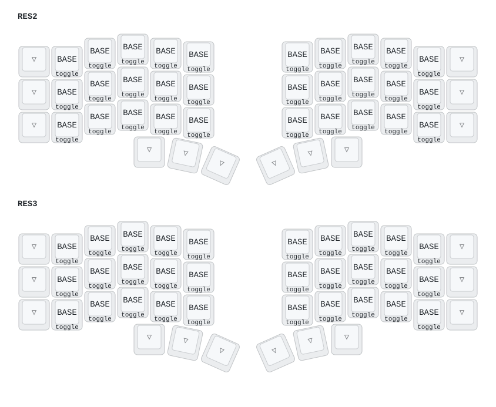

# ZMK config for beekeeb Toucan2 Keyboard

[The beekeeb Toucan2 Keyboard](https://beekeeb.com/introducing-toucan2/) is a wireless split column‑stagger
keyboard with a display and a trackpad, and an aggressive stagger on the pinky columns.

**This build is 36 keys**: three rows of five columns per half, plus three thumb keys per half. The shield's
physical layout in [boards/shields/toucan/toucan.dtsi](boards/shields/toucan/toucan.dtsi) declares 42
positions and the matrix scans six columns per half, but the outermost column on each half has no switch
fitted — which is why columns 0 and 11 are `&trans` on every layer, and why the generated images below
draw six phantom keys down the outer edges. Don't bind anything there; it is unreachable.

# Keymap

Images below are generated from [config/toucan.keymap](config/toucan.keymap) with
[keymap-drawer](https://github.com/caksoylar/keymap-drawer) — see [Regenerating the keymap images](#regenerating-the-keymap-images).

Legend per key: center = tap, bottom = hold, top = triple-tap (`3✕`) on BASE, double-tap (`2✕`) on GAME.
A double-tap on BASE just types the letter twice.
The outermost column on each half is `&trans` on every layer — those positions have no switch.

| # | Layer | How to reach it |
|---|-------|-----------------|
| 0 | BASE  | default |
| 1 | NAV   | hold left inner thumb |
| 2 | SYM   | hold right inner thumb |
| 3 | GAME  | `TAB` + `D` combo |
| 4 | GNUM  | hold left inner thumb while on GAME |
| 5 | MOU   | held for as long as a finger rests on the trackpad |
| 6 | RES2  | `TAB` + `H` combo (reserved, unmapped) |
| 7 | RES3  | `TAB` + `,` combo (reserved, unmapped) |
| 8 | ALT   | hold both inner thumbs (NAV + SYM tri-layer) |

Every key on the reserved layers, and the right half of ALT, is `&to 0` — a single tap gets you back to BASE
(except the two ALT reset keys described below). GNUM is the exception: its right half is a numpad, so the
escape there is the **right inner thumb**. MOU needs no escape — it is momentary, held by the trackpad.

## BASE

Colemak-DH. Mods live on the **home row**: `A R S T` / `N E I O` give GUI / CTRL / ALT / SHIFT on hold,
and type their letter on tap. Every letter key is a plain `&kp` — there is no tap-dance on this layer.

Home-row mods are a single hold-tap, `hrm`, with `&kp` on both branches. Nothing is nested inside it.
Earlier revisions wrapped a tap-dance in the hold-tap's tap branch; even with the hold-tap outermost that
left a perceptible delay on shifted letters, so the tap-dances moved off the mod keys entirely.
`flavor = "hold-preferred"` resolves the hold on the *press* of the next key, not its release, so a capital
appears immediately. `require-prior-idle-ms = <150>` stops fast letter rolls from firing a modifier;
`quick-tap-ms = <175>` lets a repeated letter repeat.

The bottom row used to carry tap-dances (`td0`–`td7`) on `Z X C D` / `H , . /`, with a triple-tap for
Bluetooth and layer jumps. Those are gone, for two reasons. The triple-taps were reachable by accident —
typing an ellipsis `...` fired `BT CLR` and unpaired the keyboard. Worse, a tap-dance emits nothing on
press: it waits out `tapping-term-ms` to see whether another tap is coming, and the binding only fires once
it resolves, with whatever modifiers are held *at that moment*. Releasing shift (or ctrl, or alt) before the
tap-dance resolved produced an unmodified key — `⇧Z` typed `z`, `⌃C` sent a bare `c`. Mod-morph wrappers
could have bypassed the tap-dance while a modifier was down, but eight wrappers to rescue a behavior whose
double-tap branch merely retyped the letter was not worth it: with plain `&kp`, tapping `Z` twice already
types `zz`.

The layer jumps and Bluetooth controls moved to **combos** anchored on the left outer thumb (`TAB` on BASE):

| Combo | Action |
|-------|--------|
| `TAB` + `Z` | `BT ←` — previous Bluetooth profile |
| `TAB` + `X` | `BT →` — next Bluetooth profile |
| `TAB` + `D` | jump to GAME |
| `TAB` + `H` | jump to RES2 |
| `TAB` + `,` | jump to RES3 |
| `TAB` + `.` + `/` | `BT CLR` — unpairs the current profile |

Each is `layers = <BASE>`, so none of them shadow a NAV, SYM or GAME binding. `timeout-ms = <50>` and
`require-prior-idle-ms = <150>` keep them from firing during a fast roll, and `BT CLR` takes three keys
because it is destructive. All six share the `TAB` position, so
`CONFIG_ZMK_COMBO_MAX_COMBOS_PER_KEY=7` is set in
[boards/shields/toucan/toucan_left.conf](boards/shields/toucan/toucan_left.conf) and
[toucan_right.conf](boards/shields/toucan/toucan_right.conf) — the default of 5 would silently drop one.
Tapping `TAB` on its own is unaffected: a combo candidate is released as a plain tap the moment the key
comes up.

`td10`–`td13` and the copy/paste macros (`⌃C`, `⇧⌃C`, `⌃V`, `⇧⌃V`) are still defined but no longer bound
to any key, since the outer columns are plain letters now.



## NAV

Arrows, paging, editing keys on the left; number pad and media transport on the right.
The trackpad scrolls instead of moving the cursor while this layer is held.



## SYM

Brackets and media on the left, symbols on the right. The trackpad also scrolls on this layer.



## ALT

Tri-layer: held automatically when NAV and SYM are both held. F1–F15 across the left half, the same
`KP_*` numpad as GNUM on the right half, and the firmware reset keys on the thumbs.

Reset keys live here because reaching ALT needs only the two thumb keys — no tap-dance — so they stay
reachable even if the home-row behaviors misbehave:

| Key | Binding | Effect |
|-----|---------|--------|
| Outer thumb, left half (`TAB` on BASE) | `&bootloader` | Left half reboots into the UF2 bootloader and mounts as a USB drive — copy the `.uf2` in to flash. No physical reset button needed. |
| Outer thumb, right half (`BSPC` on BASE) | `&bootloader` | Same for the right half. |
| Middle thumb, left half (`SPACE` on BASE) | `&sys_reset` | Soft-reboots the left half into the existing firmware. |
| Middle thumb, right half (`RET` on BASE) | `&sys_reset` | Soft-reboots the right half. |

Both inner thumbs are already held down to reach ALT, so press the outer or middle thumb key with your
index finger.

ZMK reset behaviors are source-specific: each key resets the half it physically sits on, which is why
there is one per side. (Combos are the exception — a combo-triggered reset always hits the central half —
so keep these as plain keys.)

ZMK Studio is compiled into the left half (`CONFIG_ZMK_STUDIO=y` plus the `studio-rpc-usb-uart` snippet in
[build.yaml](build.yaml)), but **no key is bound to `&studio_unlock`**, so it cannot be unlocked and cannot
change anything. That is deliberate: Studio's keymap is stored in the settings partition and silently
overrides the compiled `.keymap` until a "Restore Stock Settings" is performed, which is a confusing failure
mode to hit by accident. Bind `&studio_unlock` to something temporarily if you ever actually want it.

Studio could not replace flashing anyway — it edits layer bindings, but behavior properties such as a
tap-dance `tapping-term-ms` are compile-time devicetree values.



## GAME

QWERTY with the mods moved off the home row and onto the pinky column, so WASD-style play works
without hold-taps firing. `F` double-taps to `T` and triple-taps to `tt`; `X` double-taps to `Z`
and triple-taps to `zz`.



## GNUM

Numbers and paging for the GAME layer.

Both halves carry digits, but they send **different scancodes**:

| Half | Keycodes | Use |
|------|----------|-----|
| Left  | `N0`–`N9`, `PLUS`/`EQUAL`/`MINUS` | top-row digits — what most apps and text fields expect |
| Right | `KP_N0`–`KP_N9`, `KP_PLUS`/`KP_MINUS`/`KP_MULTIPLY`/`KP_DOT`/`KP_EQUAL` | a real numpad, for apps that distinguish it (games, CAD, spreadsheets) |

The right half is laid out like a physical numpad — digits in the middle three columns, `+` `-` `0` down the
inner column, `.` `*` `=` down the outer:

```
+  7 8 9 .
-  4 5 6 *
0  1 2 3 =
```

Tap the right inner thumb to return to BASE.



## MOU

Mouse buttons on the thumbs, held for as long as a finger rests on the trackpad (the
`is_touching_processor` node in [boards/shields/toucan/toucan.dtsi](boards/shields/toucan/toucan.dtsi)
watches `INPUT_BTN_TOUCH` and holds `&mo 5`).

| Thumb | Left half | Right half |
|-------|-----------|------------|
| outer (`TAB` / `BSPC` on BASE) | right click | middle click |
| middle (`SPACE` / `RET` on BASE) | left click | left click |
| inner (`NAV` / `SYM` on BASE) | `&trans` | `&trans` |

Every other key is `&trans`, so resting a finger on the pad never changes what the letters type. The inner
thumbs are deliberately left alone: they hold NAV and SYM, and the listener's `scroller` override is
`layers = <1 2>`, so shadowing them with clicks would make the scroll gesture unreachable while a finger is
on the pad.

Holding a thumb and moving the finger is click-and-drag. The trackpad's own `press-and-hold` gesture drags
too — the driver holds `INPUT_BTN_0` down for as long as the gesture stays asserted — but it only fires if
the finger sits still inside `tap-distance` for the whole `hold-time`, both set on the `tps43_trackpad` node
in [toucan_right.overlay](boards/shields/toucan/toucan_right.overlay).

## Reserved layers

RES2/RES3 are empty placeholders, reachable with the `TAB` + `H` and `TAB` + `,` combos.



## Regenerating the keymap images

```sh
pip install keymap-drawer

# re-parse the keymap, then hand-merge the tap-dance legends and combo labels
# into keymap-drawer/toucan.yaml
keymap parse -z config/toucan.keymap

# redraw
for layer in BASE NAV SYM ALT GAME GNUM; do
    keymap draw keymap-drawer/toucan.yaml -s "$layer" -o "keymap-drawer/img/$(echo "$layer" | tr 'A-Z' 'a-z').svg"
done
keymap draw keymap-drawer/toucan.yaml -s RES1 RES2 RES3 -o keymap-drawer/img/reserved.svg
```

`keymap parse` renders tap-dances as raw `&tdN` references; [keymap-drawer/toucan.yaml](keymap-drawer/toucan.yaml)
spells them out as tap/hold/double-tap legends and gives the BASE combos short labels, so edit that file
rather than overwriting it.

# Customizations

- **Keymap**: [config/toucan.keymap](config/toucan.keymap)
- **General configs**: [boards/shields/toucan/toucan_left.conf](boards/shields/toucan/toucan_left.conf) and [boards/shields/toucan/toucan_right.conf](boards/shields/toucan/toucan_right.conf)
- **Swipe shortcuts**: the `swipe_button_mapper` node in [boards/shields/toucan/toucan.dtsi](boards/shields/toucan/toucan.dtsi)
- **Invert scroll / trackpad settings**: the `tps43_trackpad` node in [boards/shields/toucan/toucan_right.overlay](boards/shields/toucan/toucan_right.overlay)

# License

The code in this repo is available under the MIT license.

The included shield nice_view_gem is modified from https://github.com/M165437/nice-view-gem licensed under the MIT License.

The linked trackpad module is based on https://github.com/geeksville/zmk_driver_azoteq

ZMK code snippets are taken from the ZMK documentation under the MIT license.

The embedded font QuinqueFive is designed by GGBotNet, licensed under under the SIL Open Font License, Version 1.1.
